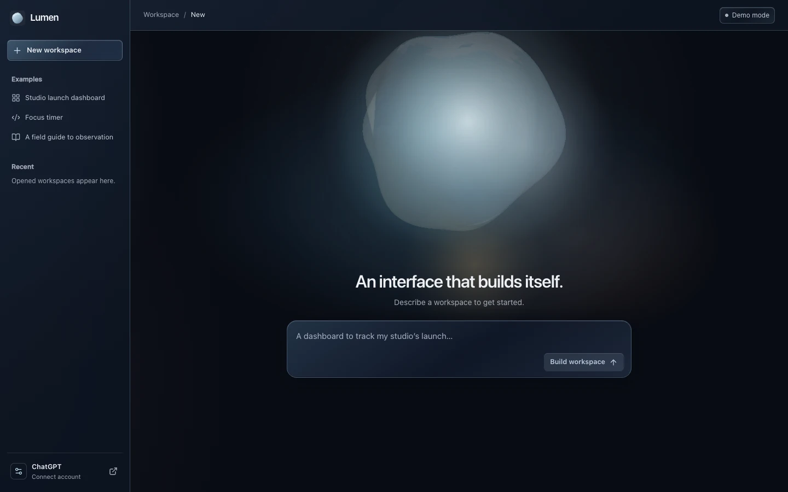
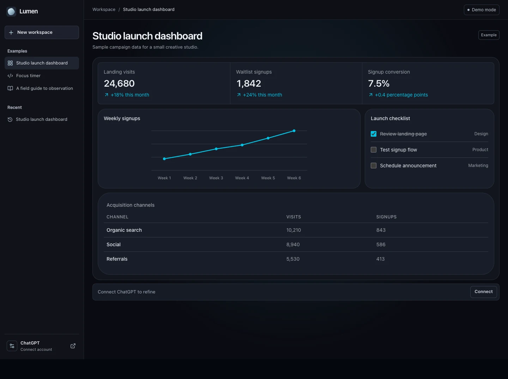
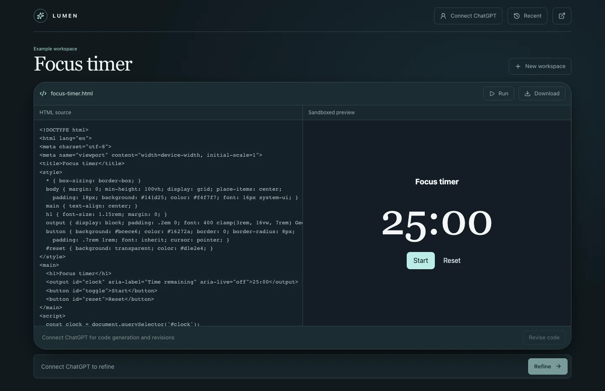
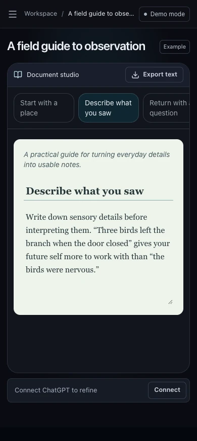

# LUMEN

LUMEN turns a plain-language prompt into an interactive workspace. Ask for a dashboard, a browser tool, a document, a conversation, vector artwork, or a short composition. The app chooses a workspace suited to the task and lets you refine its layout with a follow-up prompt.



## Run locally

Use Node.js 22 or newer and pnpm 11. The project pins the pnpm release in `package.json`.

```sh
git clone https://github.com/MustafaS22/LUMEN.git
cd LUMEN
pnpm install --frozen-lockfile
pnpm dev
```

Open [http://127.0.0.1:3000](http://127.0.0.1:3000). To run a production build locally, use `pnpm build` followed by `pnpm start`.

### Connect ChatGPT

1. Choose **Connect ChatGPT**, then **Continue with ChatGPT**.
2. Finish sign-in in the window opened by LUMEN and approve ChatGPT plan usage.
3. Return to LUMEN and build a workspace. The connection panel shows the connected account, available models, and a **Manage usage** link.

LUMEN uses [OpenAI’s Sign in with ChatGPT flow for local apps](https://developers.openai.com/siwc/token-sharing-open-source). Live features need an eligible account with plan usage enabled. Sign-in uses your operating system’s credential store, such as macOS Keychain, Windows Credential Manager, or a supported Linux desktop keyring. The three built-in examples work without an account. Set `LUMEN_AUTH_DIR` to an absolute path if you want to override the local encrypted connection directory.

## What you can do

| Workspace | How to use it |
| --- | --- |
| Dashboard | Read metrics, charts, tables, and timelines. Tick tasks in a dashboard checklist. |
| Code studio | Build or edit a single HTML file, run it in a sandboxed browser preview, request AI revisions, and download the file. |
| Documents | Edit sections, navigate the outline, and export the document as plain text. |
| Conversation | Ask a follow-up in a workspace that carries the topic and chat context. |
| Vector studio | Turn a prompt into a downloadable SVG illustration, icon, or simple poster. |
| Music studio | Compose a short multitrack piece and play it back with Web Audio. |

**Try it without signing in.** Open **Studio launch dashboard**, start the **Focus timer**, or edit **A field guide to observation**. The library’s **Recent** section keeps up to eight layouts in this browser, including dashboard checklist changes and document edits. Download code or artwork you want to keep. Recent layouts do not store chat transcripts or media outputs.

### Studio launch dashboard



### Focus timer



### Document studio on mobile



## How it works

- **Next.js App Router** serves the React workspace and the loopback-only API routes.
- **OpenAI Responses API** uses the plan authorized by the signed-in user. The official local DevKit manages authorization, token refresh, and encrypted connection storage. Browser code receives connection status and model names.
- **Zod** validates model-generated layouts, music notes, and vector primitives before rendering them. Code runs in an isolated iframe with restrictions on external resources. Downloaded HTML runs under the policy of whatever environment opens it, so review it before sharing or hosting it.
- **Three.js** renders the glass object where WebGL is available. The workspace uses translucent surfaces that frost the scene behind them. The app shows a still of the same scene when WebGL or motion is disabled.

LUMEN is designed to run on your own machine. Keep it bound to loopback and avoid exposing or forwarding its local port. Prompts and the context required to answer them go to OpenAI when you use connected features. The dashboard shows the data you supply or explicitly labeled sample data. ChatGPT plan usage currently supports the text features used here, and the vector studio builds SVGs from validated text output. See [OpenAI’s preview limitations](https://developers.openai.com/siwc/token-sharing-open-source/preview-limitations).

## Development

```sh
pnpm typecheck
pnpm build
```

GitHub Actions runs both checks on pushes to `main` and on pull requests. The upstream OpenAI DevKit sources in [`vendor/siwc-local`](vendor/siwc-local) carry their own noncommercial license and attribution.
